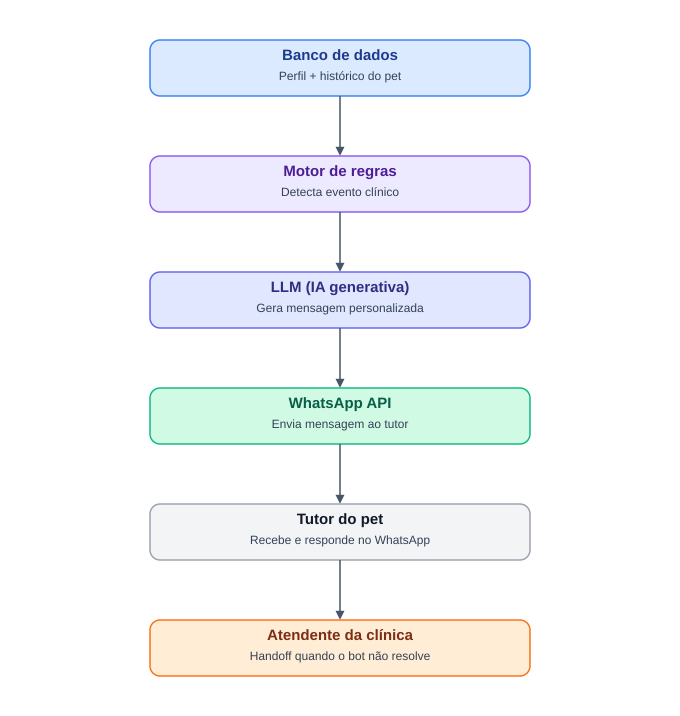

# IA Conversacional — Clyvo Vet

## 1. Descrição da solução

O Clyvo Vet enfrenta um problema estrutural: o tutor do pet só aciona a clínica em situações de urgência, o que gera baixa recorrência, menor LTV e ausência de vínculo contínuo entre clínica e tutor.

Para resolver isso, a aplicação integra um componente de **IA conversacional via WhatsApp** que acompanha o prontuário do pet e envia **mensagens proativas e personalizadas** ao tutor, cobrindo os pilares de cuidado preventivo, terapêutico e de bem-estar contínuo — sem depender do tutor lembrar de agir.

## 2. Problema de negócio

Tutores e clínicas perdem continuidade no cuidado do pet porque não existe um mecanismo automático que monitore o histórico clínico e avise proativamente sobre vacinas, medicamentos e check-ups. Isso resulta em baixa adesão preventiva e baixa recorrência de uso dos serviços da clínica.

## 3. Abordagem de IA escolhida

**Motor de regras (árvore de decisão) + IA Generativa (LLM)**, combinados:

- O **motor de regras** varre o histórico do pet e identifica eventos clínicos relevantes: vacina vencendo, medicamento em curso sem confirmação, pet em pós-operatório, check-up de rotina por fase de vida/espécie/raça.
- Quando um evento é detectado, os dados do pet + o tipo de evento são enviados como contexto para um **LLM**, que gera a mensagem final em linguagem natural, adaptada ao perfil do pet (filhote, adulto, idoso; espécie; raça).
- A mensagem é enviada via **WhatsApp API**. Se o tutor tiver uma dúvida que o bot não consegue resolver, ocorre **handoff** para um atendente humano da clínica.

**Justificativa:** essa combinação entrega personalização genuína (não lembretes genéricos) e é rápida de implementar/demonstrar, já que não exige treinar modelo — só integrar com uma API de LLM.

## 4. Dados necessários

| Dado | Origem | Uso pela IA |
|---|---|---|
| Perfil do pet (espécie, raça, idade, peso, fase de vida) | Banco de dados da aplicação | Personalizar tom e conteúdo da mensagem |
| Histórico de consultas | Banco de dados da aplicação | Detectar necessidade de check-up |
| Vacinas (tipo, data aplicada, próxima dose) | Banco de dados da aplicação | Disparar evento de vacina vencendo |
| Medicamentos (nome, dosagem, período) | Banco de dados da aplicação | Disparar evento de adesão medicamentosa |
| Exames e eventos pós-operatórios | Banco de dados da aplicação | Disparar evento de acompanhamento crítico |

## 5. Arquitetura

Banco de dados → Motor de regras (detecta evento clínico) → LLM (gera mensagem personalizada) → WhatsApp API → Tutor do pet → (se necessário) Handoff para atendente da clínica

## 6. Tecnologias

- Backend: <preencher>
- API de LLM: <ex: OpenAI GPT / Anthropic Claude>
- Integração WhatsApp: <ex: WhatsApp Business API / Twilio>
- Banco de dados: <preencher>

## 7. Status atual (Sprint 3)

Nesta etapa, o componente de IA foi **definido e documentado** (problema, abordagem, dados, arquitetura). A implementação funcional acontece na Sprint 4, quando a IA será integrada à aplicação e testada em cenários reais de uso.

## 8. Próximos passos (Sprint 4)

- Implementar o motor de regras sobre os dados reais do banco
- Integrar a chamada à API de LLM
- Conectar ao WhatsApp (envio de mensagens)
- Implementar o fluxo de handoff para a clínica
- Testar em cenários reais e gravar vídeo demonstrativo
