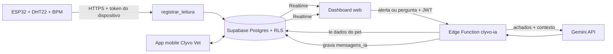

# 🐾 PetSense — Monitor IoT de Saúde do Pet com IA
### CLYVO VET | Challenge FIAP 2026 | Disruptive Architectures: IoT, IoB & Generative IA

## 📌 Descrição

O **PetSense** é um sistema de monitoramento contínuo da saúde animal por uma **coleira/roupa inteligente**. Sensores medem **temperatura corporal** e **frequência cardíaca** e enviam os dados, em tempo real, para a nuvem. Sobre esses dados e sobre o prontuário do pet (vacinas, medicamentos e consultas), uma **IA (motor de regras + LLM)** avisa o tutor de forma proativa e responde dúvidas em um chat, com encaminhamento a um atendente humano quando necessário.

## 🎯 Problema que resolve

A jornada do pet é **fragmentada e episódica**: o tutor só vai à clínica em emergências, não há acompanhamento entre as consultas, sinais de agravamento são percebidos tarde e a clínica perde recorrência. O PetSense preenche essa lacuna com dados contínuos e comunicação proativa.

## 🧠 Papel da IA

- **Motor de regras (determinístico):** decide *o que* é relevante: temperatura e BPM fora da faixa por espécie, alertas persistentes, vacina vencida ou próxima, medicamento atrasado, check-up de idoso. É auditável e testado (13 testes automatizados).
- **LLM (Gemini):** decide *como dizer*: transforma os achados em uma mensagem acolhedora e personalizada. Não diagnostica, não indica medicamentos, orienta procurar a clínica em sinais urgentes e **encaminha para atendente humano (handoff)** quando a pergunta foge do escopo.
- **Fallback:** se o LLM estiver indisponível, o sistema envia uma mensagem montada pelas regras, então o tutor nunca fica sem aviso.

Documentação completa: [`docs/ia-sprint4.md`](./docs/ia-sprint4.md) (problema, abordagem e justificativa, dados, fluxo, regras, segurança, testes).

## 🏗️ Arquitetura



## 🔧 Tecnologias

| Componente | Tecnologia |
|---|---|
| Microcontrolador (simulado) | ESP32 no Wokwi, DHT22 (temperatura), potenciômetro (BPM), LEDs, LCD I2C |
| Envio dos dados | HTTPS (POST JSON) para função SQL do Supabase (PostgREST) |
| Banco e tempo real | Supabase Postgres, Realtime, Row Level Security |
| IA | Edge Function (Deno/TypeScript) com motor de regras + Google Gemini API |
| Interface | Dashboard web (HTML/JS, supabase-js) com gráficos e chat |
| Testes | `node:test` (motor de regras) |

## 📁 Estrutura

```
petsense.ino                       # firmware do ESP32 (Wokwi)
diagram.json, libraries.txt        # circuito e bibliotecas do Wokwi
dashboard.html                     # painel em tempo real + chat com a IA
supabase/
  schema_iot_ia.sql                # função registrar_leitura (validação e limites por espécie)
  vincular_coleira.sql             # vincula a coleira a um pet e gera o token
  functions/clyvo-ia/index.ts      # Edge Function: motor de regras + Gemini
tests/regras.test.mjs              # 13 testes do motor de regras
docs/ia-sprint4.md                 # documentação técnica da IA
docs/roteiro-video-pitch.md        # roteiro do vídeo
Docs_Sprint3/                      # definição da IA (Sprint 3)
```

## ⚙️ Como executar

### Pré-requisitos
Projeto Supabase com as tabelas do app Clyvo Vet (`pets`, `vacinas`, `medicamentos`, `agendamentos`, `dispositivos`, `leituras_iot`, `mensagens_ia`, criadas pelos scripts SQL do [repositório do app](https://github.com/Vitor-Augusto-olv/clyvo-ve)) e uma chave da Gemini API (Google AI Studio).

### 1. Banco
No **SQL Editor** do Supabase, rode `supabase/schema_iot_ia.sql`. Depois rode `supabase/vincular_coleira.sql` (troque o nome do pet) e **copie o token** retornado.

### 2. IA (Edge Function)
1. Supabase → **Edge Functions** → criar função `clyvo-ia` e colar o conteúdo de `supabase/functions/clyvo-ia/index.ts` (ou `supabase functions deploy clyvo-ia` pela CLI).
2. Em **Edge Functions → Secrets**, criar `GEMINI_API_KEY` com a sua chave. Opcional: `GEMINI_MODEL` (padrão `gemini-flash-latest`).

### 3. ESP32 no Wokwi
1. Abra o [projeto Wokwi](https://wokwi.com/projects/464820469692047361), cole `petsense.ino`, `diagram.json` e `libraries.txt`.
2. Preencha `SUPABASE_URL`, `SUPABASE_ANON_KEY` (chave pública) e `DEVICE_TOKEN`. **Não publique o token real no GitHub.**
3. Clique em ▶. Ajuste a temperatura do DHT22 e o potenciômetro (BPM) para simular o pet.

### 4. Dashboard
Edite `SUPABASE_URL` e `SUPABASE_ANON_KEY` no topo de `dashboard.html`, abra o arquivo no navegador e entre com a mesma conta do app.

### 5. Testes
```bash
node --test tests/regras.test.mjs
```

## 📊 Resultados parciais

- Leituras do ESP32 chegam ao dashboard em tempo real, com gráficos e faixa normal por espécie.
- Alerta (temperatura ou BPM fora da faixa) aciona o LED vermelho, marca o dashboard e dispara a IA.
- A IA gera mensagem proativa personalizada e responde perguntas com os dados reais do pet; perguntas fora do escopo são encaminhadas a um atendente.
- Motor de regras: **13 testes automatizados passando**.

## 👥 Equipe

Challenge FIAP 2026 — 2º Ano ADS — Turmas de Fevereiro

## 📎 Links

- 🎥 Vídeo da Sprint 3: https://youtu.be/iaI_jrhwC7g
- 🎥 Vídeo da Sprint 4: <LINK_VIDEO_IOT>
- 🔗 Simulação Wokwi: https://wokwi.com/projects/464820469692047361
- 📱 App mobile: https://github.com/Vitor-Augusto-olv/clyvo-ve
- 🏥 Empresa parceira: [CLYVO VET](https://clyvo.com.br)
