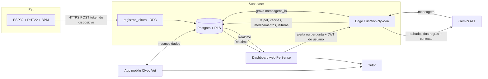

# IA Clyvo Vet — Implementação (Sprint 4)

Este documento descreve a IA implementada, evolução da definição feita na Sprint 3 (`Docs_Sprint3/ia-sprint3.md`).

## 1. Problema de negócio

O tutor só procura a clínica em urgências, e entre as consultas ninguém acompanha o pet. Sinais de agravamento passam despercebidos, vacinas e medicamentos atrasam, e a clínica perde recorrência. A IA transforma dados que já existem (prontuário e coleira IoT) em **avisos proativos e personalizados** e em um **canal de dúvidas** com a clínica.

## 2. Abordagem escolhida e justificativa

**Motor de regras + IA generativa (LLM Gemini)**, em duas camadas:

| Camada | Papel | Por que |
|---|---|---|
| Motor de regras (determinístico) | Decide **o que** é relevante: sinais vitais fora da faixa, persistência de alertas, vacina vencida, medicamento atrasado, check-up de idoso | Em saúde, a decisão não pode depender do "humor" de um modelo: é auditável, testável (13 testes automatizados) e sem custo |
| LLM (Gemini) | Decide **como dizer**: transforma os achados em uma mensagem acolhedora, adaptada ao pet | Personalização real, sem treinar modelo |

Salvaguardas: o LLM recebe apenas dados do pet do próprio usuário, é instruído a **não diagnosticar nem indicar medicamentos**, orienta procurar a clínica em sinais urgentes e, fora do escopo, **encaminha para um atendente humano (handoff)**. Se o LLM falhar, o sistema envia uma mensagem montada pelas regras, então o tutor nunca fica sem aviso.

## 3. Dados utilizados

| Dado | Origem | Estrutura | Uso pela IA |
|---|---|---|---|
| Perfil do pet | tabela `pets` (Supabase) | nome, espécie, raça, idade | Limites por espécie e personalização |
| Vacinas | tabela `vacinas` | nome, data aplicada, próximo reforço | Vacina vencida ou a vencer |
| Medicamentos | tabela `medicamentos` | nome, dosagem, próxima aplicação | Medicamento atrasado ou próximo |
| Consultas | tabela `agendamentos` | tipo, data, horário, status | Check-up de rotina |
| Sinais vitais (IoT) | tabela `leituras_iot` (preenchida pelo ESP32) | temperatura, bpm, alerta, hora | Alertas e tendência |
| Conversa | tabela `mensagens_ia` | papel, origem, conteúdo | Histórico do chat e dos alertas |

## 4. Arquitetura e fluxo de dados

Fluxo do alerta proativo:
1. O ESP32 envia temperatura e BPM a cada 5 s; a função `registrar_leitura` valida o token, descarta valores impossíveis e marca `alerta` conforme a espécie.
2. O dashboard recebe a leitura por Realtime. Se `alerta = true`, chama a Edge Function `clyvo-ia` (modo `alerta`).
3. A função lê os dados do pet **com o JWT do usuário** (a RLS garante isolamento) e roda o motor de regras.
4. Se houver achado de gravidade `atencao` ou `urgente` (e não houve alerta nos últimos 90 s), monta o contexto e chama o Gemini.
5. A mensagem é gravada em `mensagens_ia` (origem `regra`) e aparece no chat do tutor em tempo real.

Fluxo do chat: a pergunta é gravada, a função reúne o contexto atualizado do pet, o histórico recente e chama o Gemini; a resposta é gravada. Se o modelo sinalizar `[HANDOFF]`, a conversa é marcada como encaminhada a um atendente humano.

## 5. Regras implementadas

| Regra | Condição | Gravidade |
|---|---|---|
| Temperatura alta | acima de 39,5 °C (cão e gato) | atenção; urgente se ≥ limite + 1 °C |
| Temperatura baixa | abaixo de 37,5 °C (cão) ou 38,0 °C (gato) | atenção; urgente se muito abaixo |
| BPM alto / baixo | cão 60–140; gato 120–220 | atenção; urgente se muito fora |
| Alertas persistentes | 3 ou mais das últimas 5 leituras em alerta | urgente |
| Vacina vencida | reforço no passado | atenção |
| Vacina próxima | reforço em até 7 dias (info até 30 dias) | atenção / info |
| Medicamento atrasado | próxima aplicação no passado | atenção |
| Check-up de idoso | idade ≥ 8 e sem consulta agendada | info |

Os limites são **valores de referência para a prova de conceito**, e devem ser validados por veterinários antes de uso real.

## 6. Segurança e privacidade

- A chave do Gemini fica como **secret** da Edge Function, nunca no app, no dashboard ou no repositório.
- A função usa o JWT do usuário: cada tutor só enxerga os dados dos próprios pets (Row Level Security).
- O ESP32 só consegue **inserir leituras**, via função que exige o token do dispositivo. Ele não lê nem altera nenhuma outra tabela.
- Mensagens do LLM são exibidas como texto puro no dashboard (sem HTML).

## 7. Testes

- **Automatizados:** 13 testes do motor de regras (`node --test tests/regras.test.mjs`), cobrindo cenários normais, febre leve e alta, BPM alto, persistência, vacina vencida e próxima, medicamento atrasado, check-up de idoso, limites por espécie, ordenação, fallback sem LLM e handoff.
- **Fim a fim (demonstrados no vídeo):** leitura normal (sem mensagem); temperatura elevada no simulador (LED vermelho, alerta e mensagem proativa); pergunta sobre o pet (resposta contextual); pergunta fora do escopo (handoff).

## 8. Limitações e próximos passos

- O canal da Sprint 3 era o WhatsApp. Nesta entrega o canal é um **chat web simulado** com o mesmo comportamento; a integração com WhatsApp Business API é o próximo passo.
- Levar o chat e os alertas da IA também para o aplicativo mobile, com notificações push.
- Substituir o potenciômetro e o DHT22 por sensores reais (oximetria e infravermelho) e calibrar limites com a clínica.
- Usar a pergunta do tutor para sugerir e agendar consulta diretamente.
